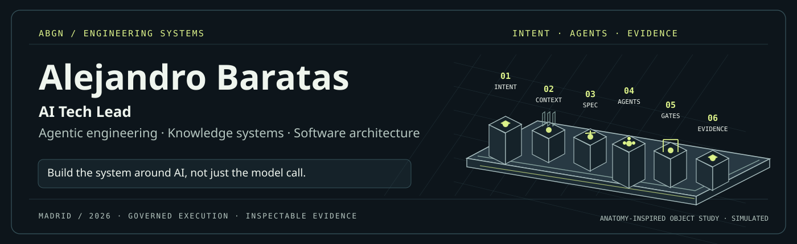
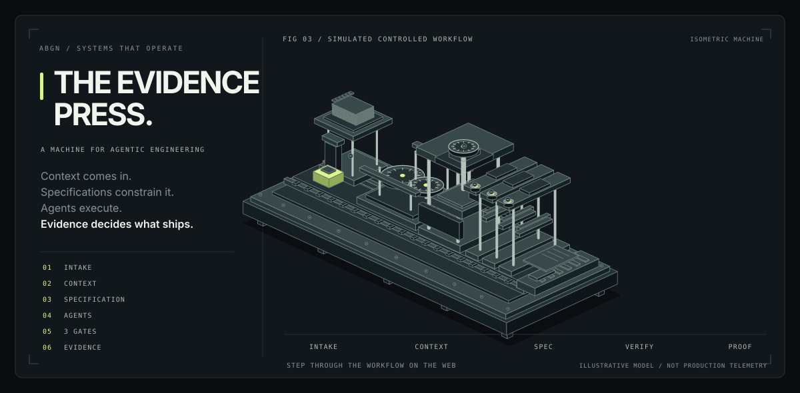
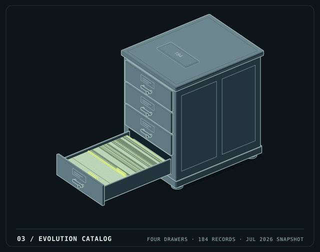

# Alejandro Baratas

**AI Tech Lead · Agentic Engineering · Knowledge Systems · Software Architecture**

I build the systems **around AI**: context, specifications, agents, controlled execution and evidence that engineering teams can inspect.

My path: **GIS → enterprise Java / distributed platforms → AI technical leadership.** Based in Madrid.

[Portfolio](https://alejandrobgn.vercel.app/) · [LinkedIn](https://www.linkedin.com/in/alejandro-bgn/) · [Email](mailto:alejandrobgn@gmail.com) · [Light banner](./assets/abgn-banner-v5-light.svg)

## 01 / The Evidence Press — how I think

<picture>
  <source media="(prefers-color-scheme: dark)" srcset="./assets/evidence-press-dark.svg">
  <source media="(prefers-color-scheme: light)" srcset="./assets/evidence-press-light.svg">
  
</picture>

The isometric machine above is a **six-stage engineering metaphor**, not a client system or a telemetry dashboard. One workpiece moves from an incoming request to a reviewable result. The gates can reject it.

| Part of the machine | What it means |
|---|---|
| **01 · Feeder** | A bounded request arrives: business need, defect or change. |
| **02 · Knowledge wheels** | Project context, KB Dev, KB Doc and reusable conventions inform the task. |
| **03 · Specification press** | Acceptance criteria and SDD limit what may be built. |
| **04 · Agent carriage** | An agent proposes a change within the allowed scope. |
| **05 · Three gates** | Definition of Ready, Definition of Done and adversarial review. A failed check stops the candidate. |
| **06 · Evidence tray** | A passing candidate has reviewable proof: changes, checks, decisions and trace. |

**How to read it:** the moving workpiece is the candidate change, the mechanisms transform or constrain it, and the exit represents a reviewed output. Every stage in this illustration is simulated.

[**Explore the interactive machine source →**](./demos/evidence-press.html) *(download the standalone HTML to open the interactive inspector)* · [**Full parts and evidence guide →**](./docs/ANATOMY-FIELD-GUIDE.md)

---

## 02 / Career Gauge — how I got here

Fig. 02 — The dial gauge measures the career chapters shown in a historical snapshot. Each block represents a role; its relative height encodes time spent in that chapter, not performance or salary. This is not a live clock.

**Seven chapters:** Esri España → Repsol / Accenture → Grupo AVALON → Hewlett Packard Enterprise → NTT DATA → Ayesa → knowmad mood.

[**Inspect the career timeline →**](https://alejandrobgn.vercel.app/experience) · [**Open full-size figure →**](./assets/career-gauge-v6-dark.svg) · [**Interpret the gauge →**](./docs/ANATOMY-FIELD-GUIDE.md#figure-02--career-gauge) · [Light SVG](./assets/career-gauge-v6-light.svg)

## 03 / Evolution Catalog — how I experiment

Fig. 03 — Four drawers = four years; each card is a research record. This is a preserved July 2026 archive snapshot, not a count of shipped applications.

| 2023 | 2024 | 2025 | 2026, through July |
|---:|---:|---:|---:|
| **14** | **15** | **39** | **116** |

**184 archived artefacts:** 133 labelled confirmed, 51 reconstructed from memory in the original archive. The distinction matters: an artefact can be an exploration, a document or an experiment; it is not necessarily a finished system.

[**Explore the evolution timeline →**](https://alejandrobgn.vercel.app/evolution) · [**Open full-size figure →**](./assets/evolution-catalog-v6-dark.svg) · [**What do the drawers mean? →**](./docs/ANATOMY-FIELD-GUIDE.md#figure-03--evolution-catalog) · [Light SVG](./assets/evolution-catalog-v6-light.svg)

---

## What I build

**AI-enabled engineering** — Adopt AI in real software delivery: project knowledge, specifications, code changes, reviews and traceable results.

**Agentic systems & platforms** — Orchestration, state, permissions, integration, evaluation, observability and governance.

**Knowledge-first modernisation** — Source-linked understanding of complex legacy repositories, canonical models, dependency graphs and controlled transformation.

**Applied R&D & communication** — Public experiments, interactive technical objects, original editorial projects and transparent evidence boundaries.

## Selected public work

| Repository | What you can actually inspect |
|---|---|
| [**alejandrobgn**](https://github.com/jandromani/alejandrobgn) | Portfolio source, case studies, interactive experiments and technical writing |
| [**A2A / Agentic Platform**](https://github.com/jandromani/A2A) | Agent capabilities, tool integrations, scoped execution, permissions and human approvals |
| [**Fabrik-Codek**](https://github.com/jandromani/Fabrik-Codek) | Local knowledge graph, RAG, adaptive retrieval and task routing |
| [**LLMTRACE**](https://github.com/jandromani/llmtrace) | Small Python tracing package: sessions, cost and errors · [PyPI](https://pypi.org/project/llmtrace/) |
| [**Intelligence Ahead**](https://github.com/jandromani/IntelligenceAhead) | Independent AI publication, [five issues](https://intelligence-ahead.vercel.app/) and [Mateo y el Algoritmo](https://intelligence-ahead.vercel.app/mateo) |
| [**THE ARK**](https://github.com/jandromani/endoftheworld) | Offline-first knowledge, local AI, maps and resilient computing research |

*These repositories do not all have the same maturity: public source, demonstrator, research and production are deliberately different categories.*

---

## Engineering focus

**Java · Python · TypeScript · Spring · Kubernetes · AWS · PostgreSQL · RAG · AI agents · observability · SDD**

[**Technical field notes →**](https://alejandrobgn.vercel.app/writing) · [**Independent publications →**](https://intelligence-ahead.vercel.app/) · [**Portfolio →**](https://alejandrobgn.vercel.app/)

**Madrid, Spain** · [alejandrobgn@gmail.com](mailto:alejandrobgn@gmail.com)

Visual provenance: the Career Gauge and Evolution Catalog preserve user-provided Anatomy-generated work, with GitHub-compatible presentation variants. The Evidence Press is an original ABGN figure inspired by Anatomy design principles, not output from the official skill. All Evidence Press animation and machine states are illustrative, never production metrics.
