<picture>
  <source media="(prefers-color-scheme: dark)" srcset="./assets/evidence-press-dark.svg">
  <source media="(prefers-color-scheme: light)" srcset="./assets/evidence-press-light.svg">
  
</picture>

# Alejandro Baratas

**AI Tech Lead · Agentic Engineering · Knowledge Systems · Software Architecture**

I build the systems *around* AI: engineering workflows that turn context and specifications into controlled execution, reviewable changes and evidence a team can inspect.

My background connects **GIS → enterprise Java and distributed systems → AI platforms and engineering leadership**.

[Portfolio](https://alejandrobgn.vercel.app/) · [LinkedIn](https://www.linkedin.com/in/alejandro-bgn/) · [Email](mailto:alejandrobgn@gmail.com)

Fig. 01 — The Evidence Press. An original, illustrative SVG mechanical model. The moving workpiece passes intake, context, specification, agent execution, three review gates and an evidence tray. It is not a production trace. The full interactive source is available in the repository; the README uses the animated SVG edition.

[**Explore the interactive Evidence Press source →**](./demos/evidence-press.html) · Download the HTML to run it locally.

---

## What I build

**AI-enabled engineering** — Bringing AI into everyday software delivery: project knowledge, specifications, code changes, evaluation and human review.

**Agentic systems & platforms** — Orchestration, state, permissions, tool integration, observability and runtime governance.

**Knowledge-first modernisation** — Turning legacy repositories and documentation into structured understanding that enables controlled migration and deterministic generation.

**Applied R&D** — Working prototypes, original explorations and technical communication that make complex systems understandable.

## Selected public work

| Project | What to inspect |
| --- | --- |
| [AI Systems Portfolio](https://github.com/jandromani/alejandrobgn) | Portfolio, architecture, technical writing, original interactive experiments |
| [A2A / Agentic Platform](https://github.com/jandromani/A2A) | Agent capabilities, tool integration, permissions, approvals and operating boundaries |
| [Fabrik-Codek](https://github.com/jandromani/Fabrik-Codek) | Local AI assistant, knowledge graph, adaptive retrieval and task routing |
| [LLMTRACE](https://github.com/jandromani/llmtrace) | Open-source Python tracing toolkit and [PyPI package](https://pypi.org/project/llmtrace/) |
| [Intelligence Ahead](https://github.com/jandromani/IntelligenceAhead) | Independent AI editorial project, [published issues](https://intelligence-ahead.vercel.app/) and [Mateo y el Algoritmo](https://intelligence-ahead.vercel.app/mateo) |
| [THE ARK](https://github.com/jandromani/endoftheworld) | Offline-first knowledge, local AI and resilient computing research |

*Public repositories have different maturity levels. A repository or prototype is not, by itself, evidence of production deployment.*

## How I got here

<picture>
  <source media="(prefers-color-scheme: dark)" srcset="./assets/career-gauge-dark.svg">
  <source media="(prefers-color-scheme: light)" srcset="./assets/career-gauge-light.svg">
  
</picture>

Fig. 02 — Career gauge. The original animated Anatomy figure maps seven career chapters from GIS administration to AI technical leadership. Values belong to its documented career snapshot.

I work as **Tech Lead AI at knowmad mood**, with an emphasis on practical AI adoption, enterprise architecture and the systems that keep agentic engineering accountable. My earlier work spans Java/Spring, cloud platforms, distributed systems, geospatial engineering and engineering leadership.

[Detailed experience →](https://alejandrobgn.vercel.app/experience)

## Independent R&D · An evolving archive

<picture>
  <source media="(prefers-color-scheme: dark)" srcset="./assets/evolution-catalog-dark.svg">
  <source media="(prefers-color-scheme: light)" srcset="./assets/evolution-catalog-light.svg">
  
</picture>

Fig. 03 — Evolution catalog. The existing Anatomy object visualises a July 2026 archival snapshot: 184 records across 2023–2026, including confirmed and reconstructed entries. These are research artefacts, not 184 commercial products.

The independent archive moves across agentic engineering, knowledge systems, governance, simulation, spatial computing and human–AI interfaces. I publish selected experiments and technical field notes rather than present every exploration as a finished product.

[Explore the archive →](https://alejandrobgn.vercel.app/evolution) · [Read the field notes →](https://alejandrobgn.vercel.app/writing)

---

**Engineering focus:** Java · Python · TypeScript · Spring · Kubernetes · PostgreSQL · AWS · RAG · agents · observability · SDD

**Madrid, Spain** · [alejandrobgn@gmail.com](mailto:alejandrobgn@gmail.com)

Visual provenance: Career gauge and Evolution catalog are user-provided Anatomy-generated SVG figures. Evidence Press is an original object study built for this README using similar isometric and mechanical principles; it has not been generated by invoking the original Anatomy skill. All workflow telemetry in Evidence Press is illustrative.